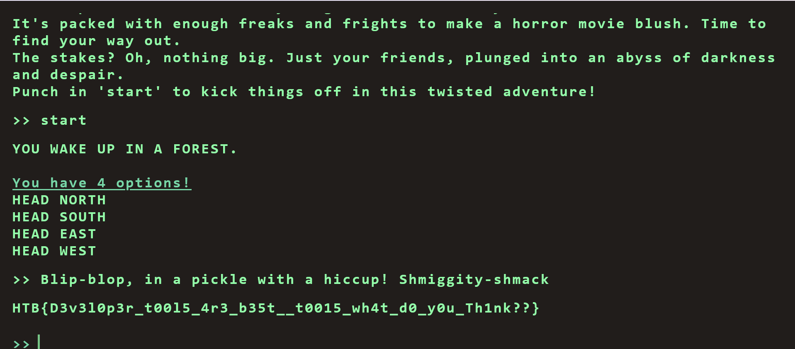

# Flag Command : Web

Embark on the "Dimensional Escape Quest" where you wake up in a mysterious forest maze that's not quite of this world. Navigate singing squirrels, mischievous nymphs, and grumpy wizards in a whimsical labyrinth that may lead to otherworldly surprises. Will you conquer the enchanted maze or find yourself lost in a different dimension of magical challenges? The journey unfolds in this mystical escape! 

# Solution

`154.57.164.72:44884` is given.
Access to `154.57.164.72:44884` and check the network tab using Developer Tools.
options is following:
```
	
allPossibleCommands	
1	
0	"HEAD NORTH"
1	"HEAD WEST"
2	"HEAD EAST"
3	"HEAD SOUTH"
2	
0	"GO DEEPER INTO THE FOREST"
1	"FOLLOW A MYSTERIOUS PATH"
2	"CLIMB A TREE"
3	"TURN BACK"
3	
0	"EXPLORE A CAVE"
1	"CROSS A RICKETY BRIDGE"
2	"FOLLOW A GLOWING BUTTERFLY"
3	"SET UP CAMP"
4	
0	"ENTER A MAGICAL PORTAL"
1	"SWIM ACROSS A MYSTERIOUS LAKE"
2	"FOLLOW A SINGING SQUIRREL"
3	"BUILD A RAFT AND SAIL DOWNSTREAM"
secret	
0	"Blip-blop, in a pickle with a hiccup! Shmiggity-shmack"
allPossibleCommands
secret
0
```
`start` this game and input secret command `Blip-blop, in a pickle with a hiccup! Shmiggity-shmack`.  


Got the flag!

`HTB{D3v3l0p3r_t00l5_4r3_b35t__t0015_wh4t_d0_y0u_Th1nk??}`

# References

# Result
https://labs.hackthebox.com/achievement/challenge/2059414/646
